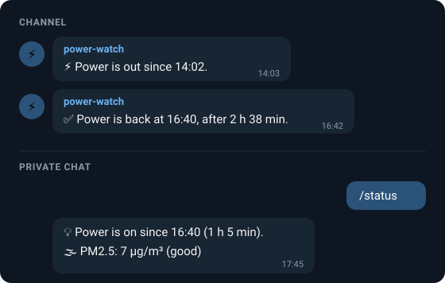
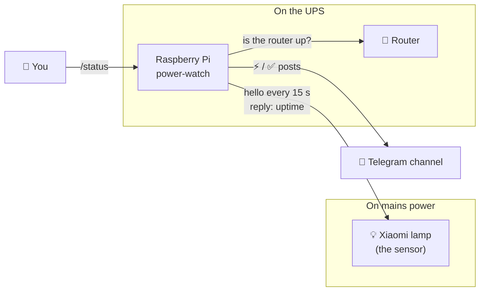
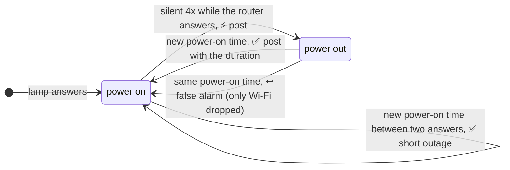

# power-watch

[](https://github.com/levadadenys/power-watch/actions/workflows/ci.yml)

[](LICENSE)

**Know when the power goes out at home, and tell a Telegram channel.** A Raspberry Pi watches a
cheap Xiaomi Wi-Fi lamp: while the lamp answers, there is power. Neighbours subscribe to the
channel; you can ask the bot `/status` (and your air purifier's readings) at any time.

<p align="center"></p>

Plain Python (standard library only; the optional purifier readings add `cryptography`), no cloud
service, no device pairing. One command to install.

## Why

In Ukraine, scheduled and emergency power outages are part of life. My router and a Raspberry Pi
sit on a UPS, so the Pi never notices an outage itself, and the internet keeps working through
most of them. That raised a question the Pi couldn't answer: *is the power on at home right now?*

The answer turned out to be on my desk. A Xiaomi lamp plugged straight into the wall answers a
tiny network "hello" while it has power, and each answer includes **how long it has been on**. So
the Pi doesn't just see that power came back: it knows *exactly when*, even if the network was
down at that moment.

And it usually is. While debugging, I noticed that every power return dropped the Pi's network for
about two minutes: the router reboots when the UPS switches back to mains (the lamp powered on in
the same second as the network link went down). power-watch is built around that: posts wait
until the network is back and still carry the right times.

## How it works



- **The probe.** Xiaomi Wi-Fi devices speak the miIO protocol: a 32-byte "hello" to UDP port
  54321 gets a reply without any pairing or token, and the reply carries the device's **uptime**.
  `now − uptime` is the moment it last powered on.
- **An outage** is the lamp going silent (4 probes in a row, about a minute) **while the router
  still answers**. If the router itself is unreachable, the lamp's silence says nothing.
- **A return** is the lamp answering with a *new* power-on time: that's when power came back.



What it handles, each with a test (the state machine in `power_watch/state.py` is pure):

- **Router reboots.** After the router has been away, the lamp gets a minute to rejoin Wi-Fi before
  its silence counts, so a router reboot isn't read as an outage. (A lamp that needs more than
  about two minutes gets a "false alarm" correction instead.)
- **Wi-Fi hiccups.** If the lamp comes back *without* having rebooted, power never went out, and
  the channel gets a correction.
- **No internet.** Posts queue up and go out once Telegram is reachable, with the real times.
- **Restarts.** The power state and unsent posts are saved (on changes only, to spare the SD card),
  so a restart neither repeats nor loses an outage.
- **Clocks.** The Pi has no clock battery: power-watch waits for NTP after a boot and adjusts
  saved times if the clock jumps. The lamp's own slow clock drift is followed too.
- **New addresses.** Every lamp has a permanent device id in its replies. If the router hands the
  lamp (or the purifier) a new IP, power-watch finds it by that id before its silence can count
  toward "out", and follows it. A different device at the lamp's old address is never mistaken
  for the lamp.

## What you need

- An always-on Linux box with systemd and Python 3.9+ (a Raspberry Pi is perfect), wired or on
  Wi-Fi in the same network as the lamp. **Put it and the router on a UPS.**
- A Xiaomi / Mi Home **Wi-Fi** device on **mains** power, NOT on the UPS: a lamp, a smart plug, an
  air purifier. Anything that works with the Mi Home app over Wi-Fi usually speaks miIO;
  Bluetooth and Zigbee devices don't.
- A Telegram bot and a channel, unless the system journal is enough.

## Quick start

**1. Telegram** (skip if the journal is enough)

1. Message [@BotFather](https://t.me/BotFather) → `/newbot`, and copy the token.
2. Create a channel: public with an @name, or private with an invite link.
3. Channel settings → Administrators → add the bot, allowed to post messages.

**2. Install**

```sh
git clone https://github.com/levadadenys/power-watch && cd power-watch
sudo ./install.sh
```

The installer builds one self-contained executable (`/usr/local/bin/power-watch`), installs the
systemd service and starts it. On the first run it:

- lists the Xiaomi devices on your network. Pick the one on **mains** power (not sure which?
  unplug it and run `power-watch --scan 192.168.0.0/24` again);
- asks for the bot token (hidden), the channel (`@name`, or empty for a private one, see the FAQ),
  who may ask the bot `/status`, and the language (English or Ukrainian), and saves them in
  `/etc/power-watch.env` (readable by root only).

To upgrade, `git pull` and run it again: your settings are kept. `sudo ./install.sh --uninstall`
removes the program and the service; your settings and state stay.

**3. Check**

```sh
sudo systemd-run --pipe --wait -q -p EnvironmentFile=/etc/power-watch.env -p DynamicUser=yes \
  /usr/local/bin/power-watch --test-notify      # a test post in the channel
journalctl -u power-watch -f                     # one line per change
```

Give it a couple of minutes after the install first: the watch needs about a minute of a healthy
network before it trusts the lamp's silence. Then unplug the lamp for three minutes: after about
one, the channel says the power is out, and when you plug it back in, that it's back.

**4. Once, in the router:** reserve the lamp's address for its MAC (*DHCP reservation* or *static
lease*). power-watch follows a lamp that got a new address, but a fixed one saves it the search.

## Ask the bot

In a private chat, `/status` (or `?`) answers with the current state, plus the air purifier's
readings when one is set up:

```
💡 Power is on since 11:23 (2 h 5 min).
🌫 PM2.5: 7 µg/m³ (good)
Purifier: auto
🧻 Filter: 63% (~120 days left)
```

The bot answers only the people in `POWER_WATCH_ALLOWED_USERS`. To add someone, have them message
the bot once: their id appears in `journalctl -u power-watch` ("ignored a message from user 123…").
Put it in the settings and `sudo systemctl restart power-watch`.

### Air purifier (optional)

Reading a purifier needs its **token** (32 hex digits) and `python3-cryptography`:

1. Get the token with [Xiaomi Cloud Tokens Extractor](https://github.com/PiotrMachowski/Xiaomi-cloud-tokens-extractor)
   (it logs in to your Mi account; run it yourself). Re-adding the device in Mi Home changes it.
2. `sudo apt install python3-cryptography`
3. Set `POWER_WATCH_PURIFIER_IP` and `POWER_WATCH_PURIFIER_TOKEN` (`sudoedit /etc/power-watch.env`),
   check with `power-watch --purifier` (run it like the test post above), then restart the service.

| Supported model | Readings |
|---|---|
| `xiaomi.airp.cpa4` (Smart Air Purifier 4 Compact) | PM2.5, mode, filter life (% and days), faults |

Another MiOT purifier needs an entry in `MODELS` in `power_watch/purifier.py`, with its property
numbers from [miot-spec](https://home.miot-spec.com). PRs welcome. A purifier problem never
affects the power status: `/status` waits at most ~5 s for it and says if it isn't answering.

## Configuration

`/etc/power-watch.env` ([example](power-watch.env.example)). One `KEY=value` per line; comments
only on their own lines.

| Variable | Default | |
|---|---|---|
| `POWER_WATCH_DEVICE_IP` | — | the sensor device, on mains power (required) |
| `POWER_WATCH_DEVICE_ID` | learned | its miIO id; set it only after replacing the device |
| `TELEGRAM_BOT_TOKEN`, `TELEGRAM_CHAT_ID` | empty | without them, only the journal |
| `POWER_WATCH_ALLOWED_USERS` | empty | Telegram user ids the bot answers `/status` for |
| `POWER_WATCH_LANG` | `en` | `en` or `uk` |
| `POWER_WATCH_TZ` | system time zone | for times in messages, e.g. `Europe/Kyiv` |
| `POWER_WATCH_LABEL` | empty | a prefix for every post, e.g. a place name |
| `POWER_WATCH_PURIFIER_IP`, `POWER_WATCH_PURIFIER_TOKEN` | empty | optional air purifier |
| `POWER_WATCH_GATEWAY` | the default route | the router's IP |
| `POWER_WATCH_GATEWAY_PORT` | `53` | TCP port checked on the router; "connection refused" counts as up |
| `POWER_WATCH_INTERVAL_S` | `15` | seconds between probes |
| `POWER_WATCH_OFF_AFTER` | `4` | missed probes before "out" (and the grace after a router outage) |

A bad value stops the service with the reason in the journal, instead of restarting forever.

## FAQ

**It posted "power is out", but the power is on.**
The lamp probably dropped off Wi-Fi for over a minute; the channel gets a "false alarm" correction
when it's back. (A lamp that got a new IP address is found and followed by its device id; the
journal says "moved … → …". Reserve the address in the router, step 4.)

**I replaced the lamp, and the journal says another device answers at its address.**
power-watch knows the old lamp by its device id, so it ignores the new one rather than guess
(it never declares an outage from it). Put the id the journal names into `POWER_WATCH_DEVICE_ID`
(`sudoedit /etc/power-watch.env`) and `sudo systemctl restart power-watch`.

**It never says the power is out.**
power-watch only counts the lamp's silence while the router answers. Check the router answers its
port: `nc -vz 192.168.0.1 53` should say "succeeded" or "refused". A timeout means it drops that
port; set `POWER_WATCH_GATEWAY_PORT` to one it answers (80, 443).

**How do I find a private channel's id?**
`sudo systemctl stop power-watch` (while it runs, the service is the bot's only reader of updates,
and `--find-chats` would get "409 Conflict"). Run `power-watch --find-chats` the way the test post
above is run: the first run also tells Telegram to deliver channel posts to the bot. Post anything
in the channel (with the bot already an admin), run `--find-chats` again, put the `-100…` id in
`TELEGRAM_CHAT_ID`, and `sudo systemctl start power-watch`.

**The "power is back" post came a few minutes late.**
Expected when your router reboots on power return: the post waits for the network. The time in it
is the real one.

**"Power came back at 16:40 after a short or unobserved outage"?**
The lamp rebooted between two probes: an outage shorter than about a minute, one that happened
while the Pi or the router was offline or the watch was restarting, or simply someone unplugging
the lamp.

**Is a public channel a privacy risk?**
It tells anyone when your home has no power. Posts contain no address or IPs (use
`POWER_WATCH_LABEL` only if you want a place name). Use a private channel to choose who sees it.

**Can I use another device than a Xiaomi one?**
Not yet. A plain ping would work with anything, but it has no power-on time, so it couldn't tell a
Wi-Fi hiccup from a real outage, or say when power came back. PRs welcome.

## Live state for other tools

`/run/power-watch/state` is rewritten on every probe as `key=value` lines with stable keys:
`power` (`on`/`off`/`unknown`), `since`, `last_on` (the lamp's last power-on), `last_off`,
`last_seen` and `checked`; every time is in epoch seconds, 0 meaning never. For example, an alert script can tell whether a network
drop was the router rebooting on power return: `last_on` within a minute or two of the drop.

## Development

```sh
python3 -m power_watch --scan 192.168.0.0/24       # run from a checkout, no install needed
python3 -m unittest discover -s tests -t .         # tests (purifier tests need `cryptography`)
pip install -r requirements-dev.txt && ruff check . && ruff format --check . && mypy
```

```
power_watch/
  probe.py     the miIO hello, the router check, LAN scan
  state.py     the outage state machine (pure: every edge case is a unit test)
  messages.py  posts and /status texts, per language
  store.py     the saved and the live state files
  telegram.py  channel posts that survive outages
  bot.py       private /status replies
  purifier.py  optional air purifier readings (encrypted miIO)
  config.py    validated settings
  watch.py     the main loop
  cli.py       the power-watch command
install.sh     build (a stdlib zipapp), install, upgrade, uninstall
```

CI runs the tests on Python 3.9–3.13 (and with `cryptography` on 3.9 and 3.13), ruff, mypy and
shellcheck, and checks that the build is reproducible. To add a language, add a block to
`MESSAGES` in `power_watch/messages.py` and in `power_watch/purifier.py`; the tests check that
every language has every key.

## Українською

power-watch пише в Telegram-канал, коли вдома зникає і повертається світло. Датчик — будь-який
Wi-Fi пристрій Xiaomi (лампа, розетка), увімкнений у звичайну розетку, **не** в ДБЖ. Роутер і
Raspberry Pi мають бути на ДБЖ. Встановлення: `sudo ./install.sh`, мова повідомлень — `uk`.

```
⚡ Світла немає з 14:02.
✅ Світло повернулося о 16:40. Не було 2 год 38 хв.
```

Боту можна написати `/status` (або «світло»): дозволеним користувачам він відповість, чи є світло,
і покаже повітря з очищувача, якщо його налаштовано.

## Contributing

Bug reports, new device models and translations are welcome: see [CONTRIBUTING.md](CONTRIBUTING.md).
Changes are listed in [CHANGELOG.md](CHANGELOG.md); security reports go through
[SECURITY.md](SECURITY.md).

## License

[MIT](LICENSE)
